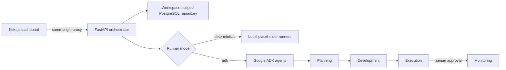

# Marketing Campaign Generator

An end-to-end campaign workspace built around a shared `CampaignState` contract. A FastAPI orchestrator advances campaigns through planning, development, execution approval, and monitoring; Google ADK agents can supply phase outputs; and a Next.js dashboard provides the operator interface.

## Architecture



| Directory | Purpose |
| --- | --- |
| `00_frontend/` | Next.js 16 campaign dashboard and backend proxy routes |
| `00_backend/` | FastAPI API, `CampaignState` models, orchestration, runners, and tests |
| `agents/` | Importable Google ADK agents for each campaign phase |

Campaign state persists in PostgreSQL across backend restarts. Firebase sessions
identify users; active database memberships determine workspace access and roles.

## Campaign lifecycle

1. Create a typed campaign brief.
2. Run planning and development.
3. Prepare execution activities and pause at the human approval gate.
4. Approve or reject execution.
5. Continue an approved campaign into monitoring.

The dashboard displays campaign status, phase progress, strategy, creative assets, execution activities, approvals, KPIs, and recommendations.

## Prerequisites

- Python 3.11 or newer and uv
- Node.js 20 or newer and Bun 1.3 or newer
- PostgreSQL 16 with migrations 001–004 and separate runtime/operator grants
- A Firebase project with Google sign-in enabled, frontend public configuration,
  and Application Default Credentials (ADC) for both servers
- A Gemini API key or Vertex AI credentials when using ADK mode

## Run locally

For the first-run Docker Compose path, follow the
[Docker Compose quick start](LOCAL_DEVELOPMENT.md#docker-compose-quick-start).
The [local development and environment reference](LOCAL_DEVELOPMENT.md) also
covers native Python/Bun workflows, required and optional variables, where to
define them, and example values for the API, frontend, operator commands, and
tests.

### 1. Prepare the database and access

Follow [database setup](database/README.md#apply-migrations) to apply migrations
001–004 and role grants to a dedicated PostgreSQL database. Use runtime credentials
for the API and separate operator credentials for provisioning. The disposable
integration-test database is not storage for real campaigns.

For a new installation, use [operator commands](database/OPERATIONS.md) to create a
workspace and explicitly assign an existing Firebase UID a role. For existing
in-memory campaigns, follow the export/import runbook before stopping the old
backend; import creates its own new workspace. Signing in alone grants no access.

### 2. Start the backend

```bash
cd 00_backend
uv sync --locked
cp .env.example .env
# Edit .env: set runtime DATABASE_URL and GOOGLE_CLOUD_PROJECT; configure ADC.
.venv/bin/uvicorn main:app --reload --port 8080
```

The API is available at `http://localhost:8080`; interactive OpenAPI documentation is at `http://localhost:8080/docs`.

Verify it with:

```bash
curl http://localhost:8080/health
```

### 3. Start the frontend

In another terminal:

```bash
cd 00_frontend
bun install --frozen-lockfile
cp .env.example .env.local
# Set your Firebase public configuration and configure ADC for the frontend server.
bun run dev
```

Open `http://localhost:3000`, sign in, and select a workspace (a sole workspace is
selected automatically). The browser talks to same-origin Next.js route handlers, which proxy campaign requests to the backend.

## Runner modes

The backend defaults to deterministic runners. They generate schema-valid placeholder results without model calls, making local development and tests reproducible.

To call the agents in `agents/`, enable ADK mode and provide authentication:

```bash
cd 00_backend
export CAMPAIGN_RUNNER_MODE=adk
export GEMINI_API_KEY=your-key
.venv/bin/uvicorn main:app --reload --port 8080
```

You can use `GOOGLE_API_KEY` instead. For Vertex AI, set `GOOGLE_GENAI_USE_VERTEXAI=true`, `GOOGLE_CLOUD_PROJECT`, and `GOOGLE_CLOUD_LOCATION`, then configure Application Default Credentials.

The ADK runner adapter:

- creates an isolated session for each phase run;
- serializes the current campaign into session state;
- explicitly exposes completed upstream phase outputs to subagents;
- requests the phase's JSON schema;
- validates the final response back into the corresponding `CampaignState` output model.

`GET /health` reports the active runner mode.

## API

| Method | Route | Description |
| --- | --- | --- |
| `GET` | `/health` | Service health and runner mode |
| `GET` | `/api/v1/workspaces` | Discover active memberships and roles |
| `POST` | `/api/v1/campaigns` | Create a campaign |
| `GET` | `/api/v1/campaigns` | List campaigns |
| `GET` | `/api/v1/campaigns/{id}` | Get campaign state |
| `POST` | `/api/v1/campaigns/{id}/run` | Advance until complete or blocked by approval |
| `POST` | `/api/v1/campaigns/{id}/phases/{phase}/run` | Run one valid phase |
| `POST` | `/api/v1/campaigns/{id}/execution/approval` | Approve or reject execution |

Workspace/campaign endpoints require `Authorization: FirebaseSession <session>`.
Campaign endpoints also require `X-Workspace-ID: <UUID>`. The frontend proxy supplies
the verified session and selected workspace. Roles are cumulative: viewer reads,
editor creates, runner executes phases, and approver records decisions.

See [backend API contracts](00_backend/README.md#api-contract) for request bodies,
ownership and approval provenance, and error statuses. Invalid lifecycle or
concurrent transitions return `409`.

## Configuration

Backend variables are loaded and validated by `campaign.config.Settings` from the process environment and an optional `00_backend/.env` file.

| Variable | Default | Purpose |
| --- | --- | --- |
| `DATABASE_MODE` | `local` | `local` URL or private `cloud_sql` IAM connection |
| `DATABASE_URL` | unset | Required runtime PostgreSQL URL in local mode |
| `DATABASE_INSTANCE` / `DATABASE_NAME` / `DATABASE_USER` | unset | Required in Cloud SQL mode; URL must be unset |
| `CAMPAIGN_RUNNER_MODE` | `deterministic` | Select `deterministic` or `adk` runners |
| `PORT` | `8080` | Backend port when running `main.py` |
| `LOG_LEVEL` | `info` | Backend logging level |
| `GEMINI_API_KEY` / `GOOGLE_API_KEY` | unset | Gemini authentication for ADK mode |
| `GOOGLE_GENAI_USE_VERTEXAI` | `false` | Use Vertex AI instead of the Gemini API |
| `GOOGLE_CLOUD_PROJECT` | unset | Firebase Admin project; also used by Vertex AI |
| `GOOGLE_CLOUD_LOCATION` | `us-central1` | Vertex AI region |
| `API_URL` | `http://localhost:8080` | Server-side backend URL used by the frontend proxy |

See [backend configuration](00_backend/.env.example) and
[frontend configuration](00_frontend/.env.example). Operator commands use explicit
`OPERATOR_DATABASE_*` process settings, not the API connection or `.env`. Do not
commit secrets. Browser Firebase configuration is public; model API keys and
service-account credentials remain server-side.

## Tests and builds

Changes follow the [spec-driven development workflow](specs/README.md): define
requirements and acceptance scenarios, plan the implementation, then record
validation evidence alongside the code. Start with the
[workspace authorization spec](specs/001-workspace-authorization/spec.md). The
[lifecycle baseline](specs/000-campaign-lifecycle/spec.md) records historical behavior.

Run backend tests:

```bash
cd 00_backend
uv sync --locked
.venv/bin/python -m 'not integration'
```

For the full suite, including PostgreSQL migration tests, follow the
[disposable database test instructions](database/README.md#disposable-postgresql-tests).

Validate the frontend (run build and browser checks sequentially):

```bash
cd 00_frontend
bun run test
bun run lint
bun run build
bunx playwright install chromium --only-shell
bun run test:browser
```

## Current limitations

- Workspace/membership administration uses operator commands; there is no invitation or administration UI.
- Deterministic runners are placeholders, not live channel integrations.
- Execution prepares publication activities but does not publish to external advertising, email, or social platforms.
- Monitoring returns an empty-data baseline until channel analytics are connected.
- Campaign content and execution packages require human review.

## Responsible use

Review generated content before publication. Verify claims, protect customer data, respect consent and opt-out requirements, follow platform policies, and comply with applicable advertising and privacy laws.
