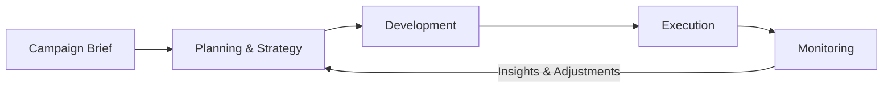

# Marketing Campaign Generator

> An intelligent, multi-agent system for planning, developing, executing, and optimizing brand-awareness campaigns.

The **Marketing Campaign Generator** transforms a campaign objective into a coordinated marketing strategy. Specialized agents collaborate across the campaign lifecycle—from audience research and positioning to channel execution, KPI reporting, and continuous improvement.

## Overview

Marketing campaigns often require multiple teams, tools, and handoffs. This project organizes that work into four focused agent groups:

1. **Planning & Strategy** — defines the campaign direction.
2. **Development** — turns the strategy into content and a media plan.
3. **Execution** — launches and coordinates campaign activity.
4. **Monitoring** — measures performance and recommends improvements.



## Agent Architecture

### 1. Planning & Strategy Agent

Builds the strategic foundation of the campaign.

- **Goal & Objective Agent** — converts business goals into measurable campaign objectives.
- **Research & Audience Agent** — researches the market and defines target audience segments.
- **Positioning & Value Proposition Agent** — establishes the campaign's differentiated position and core value.
- **Key Messages & Channels Agent** — defines key messages and recommends the right communication channels.
- **Budgeting Agent** — allocates budget across tactics, channels, and campaign phases.

### 2. Development Agent

Transforms the approved strategy into campaign-ready assets and plans.

- **Content Design & Creation Agent** — produces concepts, copy, creative briefs, and content variations.
- **Message & Value Proposition Agent** — adapts the campaign message to each audience and format.
- **Channel Selection & Media Planning Agent** — builds the channel mix, media plan, and delivery approach.

### 3. Execution Agent

Coordinates campaign publishing and delivery.

- **Social Media Executor** — prepares and publishes platform-specific social content.
- **Email Newsletter Executor** — creates and delivers email campaign sequences.
- **Digital Ad Executor** — prepares paid advertising campaigns and creative variations.
- **Channel Coordinator** — keeps messaging and timing consistent across channels.
- **Scheduler** — manages the campaign calendar and publishing cadence.

### 4. Monitoring Agent

Measures results and feeds insights back into the campaign strategy.

- **KPI Reporter** — tracks performance against campaign objectives.
- **Campaign Analyzer** — identifies trends, strengths, risks, and opportunities.
- **Tactic & Strategy Adjuster** — recommends changes based on campaign performance.
- **Stakeholder Insight Reporter** — turns campaign data into clear, decision-ready updates.

## Campaign Workflow

| Phase | Input | Output |
| --- | --- | --- |
| Planning | Campaign brief and business goals | Objectives, audience, positioning, messages, channels, and budget |
| Development | Approved campaign strategy | Creative assets, content variants, and media plan |
| Execution | Campaign assets and schedule | Coordinated social, email, and digital advertising activity |
| Monitoring | Channel and campaign performance data | KPI reports, insights, and optimization recommendations |

## Key Capabilities

- End-to-end brand-awareness campaign generation
- Audience-led strategy and positioning
- Cross-channel content and media planning
- Coordinated social, email, and digital ad execution
- Budget allocation and campaign scheduling
- KPI reporting and performance analysis
- Continuous tactical and strategic optimization
- Stakeholder-friendly campaign reporting

## Example Campaign Brief

```yaml
brand: Acme
campaign_goal: Increase brand awareness
target_audience: Small business owners
duration: 8 weeks
budget: 25000 USD
channels:
  - social_media
  - email
  - digital_ads
success_metrics:
  - reach
  - impressions
  - engagement_rate
  - branded_search_lift
```

## Getting Started

The project is currently in the design stage. Once the implementation is available, this section will include:

- Prerequisites and environment setup
- Installation instructions
- Model and provider configuration
- Required channel integrations
- Commands for generating and running a campaign

## Roadmap

- [ ] Define shared campaign data models
- [ ] Implement planning and strategy workflows
- [ ] Add content development pipelines
- [ ] Connect social, email, and advertising platforms
- [ ] Build scheduling and channel coordination
- [ ] Add campaign analytics and KPI dashboards
- [ ] Introduce human approval checkpoints
- [ ] Add automated optimization recommendations

## Responsible Use

Campaign content should be reviewed by a human before publication. Teams should verify claims, protect customer data, follow platform policies, respect consent and opt-out requirements, and comply with applicable advertising and privacy laws.

## Contributing

Contributions, ideas, and feedback are welcome. Open an issue to propose a feature or describe a problem before submitting a major change.

## License

Add the project's license here before distribution.

---

Built to help marketing teams move from **brief** to **measurable campaign** with clarity, consistency, and speed.
