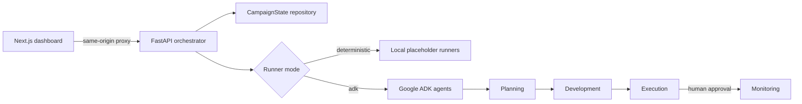

# Marketing Campaign Generator

An end-to-end campaign workspace built around a shared `CampaignState` contract. A FastAPI orchestrator advances campaigns through planning, development, execution approval, and monitoring; Google ADK agents can supply phase outputs; and a Next.js dashboard provides the operator interface.

## Architecture



| Directory | Purpose |
| --- | --- |
| `00_frontend/` | Next.js 14 campaign dashboard and backend proxy routes |
| `00_backend/` | FastAPI API, `CampaignState` models, orchestration, runners, and tests |
| `agents/` | Importable Google ADK agents for each campaign phase |

Campaign state is currently stored in memory. Restarting the backend clears all campaigns.

## Campaign lifecycle

1. Create a typed campaign brief.
2. Run planning and development.
3. Prepare execution activities and pause at the human approval gate.
4. Approve or reject execution.
5. Continue an approved campaign into monitoring.

The dashboard displays campaign status, phase progress, strategy, creative assets, execution activities, approvals, KPIs, and recommendations.

## Prerequisites

- Python 3.11 or newer
- Node.js 20 or newer and npm
- A Gemini API key or Google Cloud credentials only when using ADK mode

## Run locally

### 1. Start the backend

```bash
cd 00_backend
python -m venv .venv
source .venv/bin/activate
pip install -r requirements.txt
cp .env.example .env
uvicorn main:app --reload --port 8080
```

The API is available at `http://localhost:8080`; interactive OpenAPI documentation is at `http://localhost:8080/docs`.

Verify it with:

```bash
curl http://localhost:8080/health
```

### 2. Start the frontend

In another terminal:

```bash
cd 00_frontend
npm install
cp .env.example .env.local
npm run dev
```

Open `http://localhost:3000`. The browser talks to same-origin Next.js route handlers, which proxy campaign requests to the backend.

## Runner modes

The backend defaults to deterministic runners. They generate schema-valid placeholder results without model calls, making local development and tests reproducible.

To call the agents in `agents/`, enable ADK mode and provide authentication:

```bash
cd 00_backend
export CAMPAIGN_RUNNER_MODE=adk
export GEMINI_API_KEY=your-key
uvicorn main:app --reload --port 8080
```

You can use `GOOGLE_API_KEY` instead. For Vertex AI, set `GOOGLE_GENAI_USE_VERTEXAI=true`, `GOOGLE_CLOUD_PROJECT`, and `GOOGLE_CLOUD_LOCATION`, then configure Application Default Credentials.

The ADK runner adapter:

- creates an isolated session for each phase run;
- serializes the current campaign into session state;
- explicitly exposes completed upstream phase outputs to subagents;
- requests the phase's JSON schema;
- validates the final response back into the corresponding `CampaignState` output model.

`GET /health` reports the active runner mode.

## API

| Method | Route | Description |
| --- | --- | --- |
| `GET` | `/health` | Service health and runner mode |
| `POST` | `/api/v1/campaigns` | Create a campaign |
| `GET` | `/api/v1/campaigns` | List campaigns |
| `GET` | `/api/v1/campaigns/{id}` | Get campaign state |
| `POST` | `/api/v1/campaigns/{id}/run` | Advance until complete or blocked by approval |
| `POST` | `/api/v1/campaigns/{id}/phases/{phase}/run` | Run one valid phase |
| `POST` | `/api/v1/campaigns/{id}/execution/approval` | Approve or reject execution |

Invalid lifecycle transitions return HTTP `409`.

## Configuration

Backend variables are loaded and validated by `campaign.config.Settings` from the process environment and an optional `00_backend/.env` file.

| Variable | Default | Purpose |
| --- | --- | --- |
| `CAMPAIGN_RUNNER_MODE` | `deterministic` | Select `deterministic` or `adk` runners |
| `PORT` | `8080` | Backend port when running `main.py` |
| `LOG_LEVEL` | `info` | Backend logging level |
| `GEMINI_API_KEY` / `GOOGLE_API_KEY` | unset | Gemini authentication for ADK mode |
| `GOOGLE_GENAI_USE_VERTEXAI` | `false` | Use Vertex AI instead of the Gemini API |
| `GOOGLE_CLOUD_PROJECT` | unset | Vertex AI project |
| `GOOGLE_CLOUD_LOCATION` | `us-central1` | Vertex AI region |
| `API_URL` | `http://localhost:8080` | Server-side backend URL used by the frontend proxy |

Do not commit real credentials. Browser code does not need an API key.

## Tests and builds

Run backend tests:

```bash
cd 00_backend
source .venv/bin/activate
pytest
```

Build the frontend:

```bash
cd 00_frontend
npm run build
```

## Current limitations

- Campaign storage is in memory rather than a durable database.
- Deterministic runners are placeholders, not live channel integrations.
- Execution prepares publication activities but does not publish to external advertising, email, or social platforms.
- Monitoring returns an empty-data baseline until channel analytics are connected.
- Campaign content and execution packages require human review.

## Responsible use

Review generated content before publication. Verify claims, protect customer data, respect consent and opt-out requirements, follow platform policies, and comply with applicable advertising and privacy laws.
